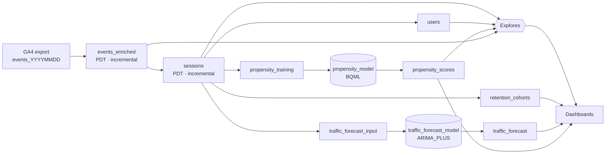

# Web Analytics & Business Intelligence Platform

A LookML analytics layer that turns the raw **GA4 BigQuery event export** into fast, governed
session, user, retention, forecast and purchase-propensity analytics — plus local verification and warehouse validation tools: a synthetic GA4 data generator, an independent ground-truth calculator, a data-quality
assertion suite and a measured before/after benchmark harness.

> **Why this exists.** The GA4 export is one nested row per event. Almost every business question
> (conversion by channel, retention, funnel) needs sessions, so analysts end up re-unnesting
> `event_params` in every query. The platform does that work once, incrementally, and exposes the result
> through a small set of explores and dashboards.

## Features

| Area | What you get |
|---|---|
| **Sessionization** | Incremental PDTs: `events_enriched` → `sessions`, partitioned by `session_date`, clustered for user/session lookups. Midnight-crossing sessions handled by construction. |
| **Channel grouping** | 12-channel ordered rule set (Direct, Paid/Organic Search & Social, Video, Display, Email, Affiliates, Referral…) with tunable regex constants. |
| **Engagement & conversion** | GA4-style engaged sessions, engagement/bounce rate, conversion rate, AOV, revenue per session, session-level purchase funnel. |
| **Users & segments** | Lifetime value, revenue deciles, lifecycle segments (Visitor → Loyal Customer), acquisition channel. |
| **Retention** | Weekly acquisition-cohort retention matrix. |
| **Forecasting** | `ARIMA_PLUS` 30-day sessions forecast per channel with 90% intervals and model diagnostics. |
| **Propensity** | Weekly-retrained purchase-propensity model (BigQuery ML logistic regression), hold-out metrics and feature importance. |
| **Dashboards** | Traffic Overview · Acquisition & Channels · Retention & Prediction · Funnels, Goals & Behavior. |
| **Growth analytics** | Six-step ordered event/page funnels, custom goals, navigation transitions, items, custom parameters/properties and session history through an extended model. |
| **Revenue analysis** | Optional purchasing-session regression with log-scale evaluation and feature importance. |
| **Guardrails** | Mandatory date filter, partition-pruning joins, HLL++ unique users, ML training guard. |
| **Quality gates** | 7 SQL assertions + numeric reconciliation against a pure-Python reference implementation. |

## Architecture



Full rationale (session-date design, intraday wildcard trap, datagroups, cost controls):
[docs/ARCHITECTURE.md](docs/ARCHITECTURE.md).

## Tech stack

* **Looker / LookML** — views, explores, PDTs (incremental), datagroups, LookML dashboards
* **Google BigQuery** — GA4 export source, partitioned/clustered scratch tables
* **BigQuery ML** — `LOGISTIC_REG`, `ARIMA_PLUS`
* **Python 3.12** — data generator, loader, assertion runner, benchmark harness (`google-cloud-bigquery`, `PyYAML`; tests use stdlib `unittest`)
* **GitHub Actions** — lint + unit tests

## Repository layout

```
manifest.lkml                  constants (connection, source dataset, channel regexes, ML settings)
models/sessionlens.model.lkml  model + includes
attributes/                    datagroups, value formats
views/core/                    events_enriched, sessions
views/audience/                users, retention_cohorts
views/ml/                      propensity_*, traffic_forecast*
explores/                      explore definitions
dashboards/                    3 core LookML dashboards
extensions/                    growth explores/dashboard · optional revenue regression
tools/                         generator · loader · reference metrics · assertions · benchmark · LookML linter
tests/                         unit tests + SQL data-quality assertions
benchmarks/                    baseline/optimized query pairs, results
schema/                        GA4 export schema for loading synthetic data
docs/                          architecture, data model, deployment, limitations
```

## Quick start

```bash
git clone <your-repo-url> && cd sessionlens
make setup
python3 -m pip install -r requirements-growth-test.txt
make test                       # LookML consistency lint + unit tests (no cloud access needed)

# Optional: synthetic data at scale
make generate EVENTS=50000000 USERS=2000000 DAYS=90
make load PROJECT=my-proj DATASET=ga4_synth
```

Then point the Looker constants at your dataset and build — see [docs/DEPLOYMENT.md](docs/DEPLOYMENT.md).

## Example questions it answers

* Which channels drive the highest **revenue per session**, and how has that moved week over week?
* Where do sessions drop in the **view item → cart → checkout → purchase** funnel, by device?
* What share of the Week-0 cohort is still active in **Week 8**?
* Which **lifecycle segment** contains the most high-intent users right now?
* What traffic should we expect from **Paid Search** over the next 30 days, with what uncertainty?

## Testing & data quality

| Layer | How | Where |
|---|---|---|
| Static LookML consistency | brace balance, `${view.field}` and `SQL_TABLE_NAME` references, dashboard fields vs. model | `tools/lint_lookml.py` |
| Generator correctness | determinism, date/shard consistency, session-number continuity, midnight spill, reference ≡ manifest | `tests/test_tooling.py` (8 tests) |
| Extension SQL | Ordered funnels, goals, paths, optional arrays and session history in DuckDB; Liquid/SQL adapters | `tests/test_growth_extensions.py` |
| Operational regression | Training guard, refresh metadata, benchmark equivalence and stale-source detection | `tests/test_operations.py` |
| Warehouse assertions | key uniqueness, nulls, time ordering, revenue/purchase coherence, channel coverage, event-count reconciliation | `tests/sql/*.sql` via `tools/run_assertions.py` |
| Ground-truth reconciliation | PDT totals must equal the pure-Python reference on the same files | `tools/run_assertions.py --reference` |

## Performance & benchmarking

Performance claims in this repository are **only** the ones produced by the harness:

```bash
make benchmark PROJECT=my-proj DATASET=ga4_synth SESSIONS=<scratch sessions table> LABEL=first-run
make report LABEL=first-run   # writes benchmarks/RESULTS.md from measured jobs
```

Five baseline-vs-optimized query pairs (daily sessions by source, conversion by device, top landing pages,
unique users, purchase funnel) compare naive SQL on the raw export with the same question answered from
`sessions`. Methodology: result cache off, one discarded warm-up, median of N runs, elapsed time + slot-ms +
bytes processed/billed. Results: [benchmarks/RESULTS.md](benchmarks/RESULTS.md).

No warehouse benchmark run is currently recorded. Dataset generation and query performance
are separate measurements. Publish job-level benchmark evidence before quoting throughput
or speedups. The harness verifies result equivalence before timing, uses exact user counts,
and enforces a configurable per-query byte budget and timeout. Raw baseline queries use the
same session-date and attribution semantics; `--spill-days` controls trailing shard coverage.
See [benchmark methodology](benchmarks/METHODOLOGY.md).

## Validation status

Local tests exercise reference metrics, extension SQL and operational behavior. They do not
validate Looker's Liquid compilation, BigQuery SQL execution, PDT lifecycle, or ML training.
Deployment validation and measured model quality are pending. Follow the deployment guide
and [operations runbook](docs/OPERATIONS.md) to collect that evidence.

## Limitations

See [docs/LIMITATIONS_AND_ROADMAP.md](docs/LIMITATIONS_AND_ROADMAP.md). Highlights: session-scoped attribution
(not last-non-direct), 3-day incremental window, UTC session dates, and the LookML/BigQuery SQL needs to be
validated in a Looker instance before production use.

## Documentation

* [Growth analytics](docs/extensions/GROWTH_ANALYTICS.md) · [Operations](docs/OPERATIONS.md) · [Changes](CHANGELOG.md)

* [Architecture](docs/ARCHITECTURE.md) · [Data model](docs/DATA_MODEL.md) · [Deployment](docs/DEPLOYMENT.md) · [Limitations & roadmap](docs/LIMITATIONS_AND_ROADMAP.md)

## Prior art

The GA4 BigQuery export schema is documented by Google. Looker has published its own GA4 block; This platform uses a layered design: flatten-once `events_enriched`, `session_date`
derived from `ga_session_id`, CASE-based channel rules and in-model ML.

## License

MIT — see [LICENSE](LICENSE).
